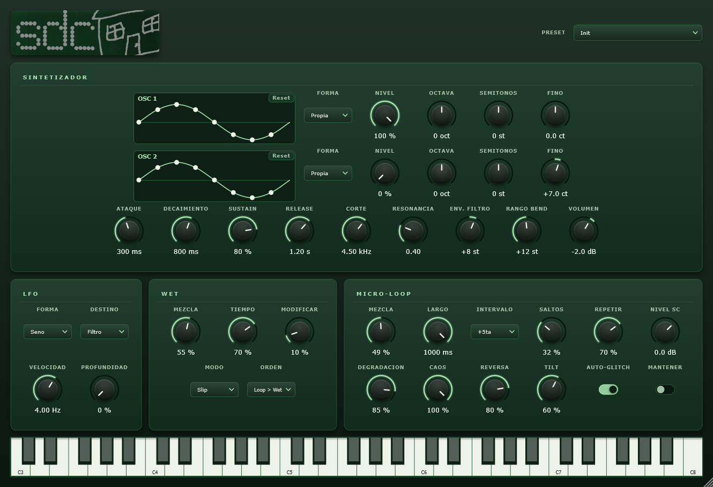

# Salir de Casa — sintetizador VST3

[English](README.md) · **Español**

[](https://github.com/pedrofelipe14/GlitchSynth/actions/workflows/build.yml)

Plugin de síntesis y efectos glitch para FL Studio (y cualquier host VST3), escrito en **C++17 con JUCE**.
Es el instrumento con el que se está grabando el primer disco de *salir de casa*.



## Qué hace

- **Dos osciladores** por voz: seno, sierra, cuadrada, triangular o una **onda propia que se dibuja arrastrando puntos** sobre el gráfico. Cada uno con nivel, octava, semitonos y afinación fina.
- **Filtro pasa-bajos resonante** con envolvente y **ADSR** de amplitud.
- **LFO por voz** hacia filtro, tono o volumen (seno, triangular, sierra, cuadrada o aleatorio).
- **Pitch bend con glide**: las *slide notes* de FL Studio funcionan de fábrica.
- **Micro-loop glitch**: graba audio en vivo, congela fragmentos, los repite transpuestos, los da vuelta y los degrada de a poco (bit/rate crush). Funciona sobre el propio sinte o sobre **audio externo por sidechain**.
- **Efectos wet**: reverb, delay y slip, con orden de ruteo configurable.
- **Presets** de fábrica y **presets de usuario** (archivos `.sdcpreset`); el estado completo se guarda en la sesión del DAW.
- **Interfaz propia** escalable, con teclado en pantalla y tocable desde el teclado de la computadora.

## Detalles técnicos

- Osciladores con **anti-aliasing PolyBLEP**. La onda propia es una curva **Catmull-Rom periódica** que se renderiza a una tabla de 256 muestras.
- La interfaz y el audio comparten datos mediante `std::atomic`, sin locks en el hilo de audio.
- Filtro *state-variable* TPT (`juce::dsp`), bloqueo de DC, *de-click* al robar voces y limitador suave de salida.
- Parámetros con `AudioProcessorValueTreeState`: automatizables desde el host y con unidades legibles (Hz, ms, st, dB).
- `LookAndFeel` propio: perillas, switches y menús dibujados a mano; la UI se escala sin deformarse.
- Build con **CMake**, que genera VST3 y una versión Standalone para probar sin DAW. CI en **GitHub Actions** compila y publica los releases.

## Descargar

El VST3 y la app Standalone para Windows se pueden bajar desde [Releases](https://github.com/pedrofelipe14/GlitchSynth/releases/latest). Copiá `Salir de Casa.vst3` a tu carpeta de plugins VST3 y reescaneá los plugins desde el DAW.

## Compilar

Requisitos: CMake 3.22+, un compilador C++17 (MSVC en Windows) y el submódulo de JUCE.

```sh
git submodule update --init --recursive
cmake -B build -G "Visual Studio 17 2022"
cmake --build build --config Release --target SalirDeCasa_All
```

El VST3 se copia solo a la carpeta de plugins al compilar: cambiala con `-DSDC_VST3_COPY_DIR="C:/ruta/a/tus/plugins"`, o desactivá la copia con `-DSDC_COPY_PLUGIN=OFF`.

Cada push compila el plugin en Windows con **GitHub Actions**, y cada tag `v*` publica un release con el plugin listo para descargar.

## Uso en FL Studio

1. Cargarlo en el Channel Rack como instrumento.
2. Para las *slide notes*, el rango de pitch bend del wrapper tiene que coincidir con la perilla **Rango Bend** (12 por defecto).
3. Para glitchear otro audio: en el mixer, *Sidechain to this track* hacia la entrada del plugin.

## Estructura

| Archivo | Qué hace |
|---|---|
| `Source/PluginProcessor.*` | Parámetros, buses de audio, `processBlock`, presets y estado |
| `Source/PluginEditor.*` | Layout de la interfaz y teclado de la computadora |
| `Source/SalirLookAndFeel.*` | Dibujo de perillas, switches y menús |
| `Source/WaveEditor.*` | Gráfico de la onda con puntos arrastrables |
| `Source/DSP/SynthVoice.*` | Voz: osciladores, ADSR, filtro, LFO, pitch bend |
| `Source/DSP/CustomWave.h` | Onda propia (curva por puntos → tabla) |
| `Source/DSP/GlitchEngine.*` | Micro-loop: grabación, repetición, reversa, degradación |
| `Source/DSP/WetEngine.*` | Reverb, delay y slip |

## Estado

En desarrollo (v0.3). Se va a publicar junto con el disco.
