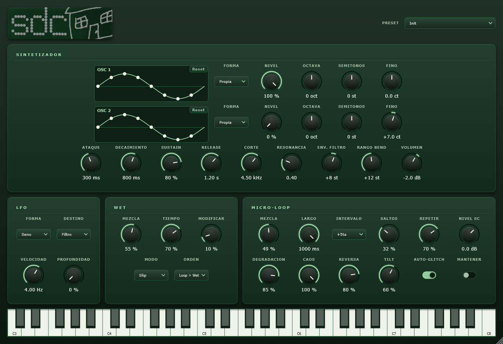

# Salir de Casa — VST3 synthesizer

**English** · [Español](README.es.md)

[](https://github.com/pedrofelipe14/GlitchSynth/actions/workflows/build.yml)

A synthesizer and glitch-effects plugin for FL Studio (and any VST3 host), written in **C++17 with JUCE**.
It's the instrument being used to record the first album by *salir de casa*.



## Features

- **Two oscillators** per voice: sine, saw, square, triangle, or a **custom waveform you shape by dragging points** on the graph. Each has its own level, octave, semitone and fine tuning.
- **Resonant low-pass filter** with envelope modulation, plus an amplitude **ADSR**.
- **Per-voice LFO** routed to filter, pitch or volume (sine, triangle, saw, square or random).
- **Pitch bend with glide**: FL Studio's *slide notes* work out of the box.
- **Glitch micro-loop**: records audio live, freezes fragments, repeats them transposed and reversed, and gradually degrades them (bit/rate crush). It runs on the synth itself or on **external audio via sidechain**.
- **Wet effects**: reverb, delay and slip, with a configurable routing order.
- **Factory and user presets** (`.sdcpreset` files); the full state is saved with the DAW session.
- **Custom, scalable UI** with an on-screen keyboard, also playable from the computer keyboard.

## Technical details

- **PolyBLEP anti-aliased** oscillators. The custom waveform is a **periodic Catmull-Rom curve** rendered into a 256-sample table.
- The UI and the audio thread share data through `std::atomic`, with no locks on the audio thread.
- TPT state-variable filter (`juce::dsp`), DC blocking, de-clicking on voice stealing, and a soft output limiter.
- Parameters built on `AudioProcessorValueTreeState`: host-automatable, with readable units (Hz, ms, st, dB).
- Custom `LookAndFeel`: knobs, switches and menus are drawn from scratch, and the UI scales without distortion.
- Built with **CMake**, producing a VST3 plus a Standalone app for testing without a DAW. **GitHub Actions** CI builds every push and publishes releases.

## Download

The Windows VST3 and Standalone app are available under [Releases](https://github.com/pedrofelipe14/GlitchSynth/releases/latest). Copy `Salir de Casa.vst3` into your VST3 plugin folder and rescan plugins in your DAW.

## Building

Requirements: CMake 3.22+, a C++17 compiler (MSVC on Windows) and the JUCE submodule.

```sh
git submodule update --init --recursive
cmake -B build -G "Visual Studio 17 2022"
cmake --build build --config Release --target SalirDeCasa_All
```

After building, the VST3 is copied to your plugin folder. Change the folder with `-DSDC_VST3_COPY_DIR="C:/path/to/your/plugins"`, or turn the copy off with `-DSDC_COPY_PLUGIN=OFF`.

Every push builds the plugin on Windows with **GitHub Actions**, and every `v*` tag publishes a release with the plugin ready to download.

## Using it in FL Studio

1. Load it in the Channel Rack as an instrument.
2. For *slide notes*, set the wrapper's pitch bend range to match the **Rango Bend** (bend range) knob, which defaults to 12.
3. To glitch other audio: in the mixer, use *Sidechain to this track* into the plugin's input.

## Project layout

| File | What it does |
|---|---|
| `Source/PluginProcessor.*` | Parameters, audio buses, `processBlock`, presets and state |
| `Source/PluginEditor.*` | UI layout and computer-keyboard input |
| `Source/SalirLookAndFeel.*` | Drawing of knobs, switches and menus |
| `Source/WaveEditor.*` | Waveform graph with draggable points |
| `Source/DSP/SynthVoice.*` | Voice: oscillators, ADSR, filter, LFO, pitch bend |
| `Source/DSP/CustomWave.h` | Custom waveform (point curve → table) |
| `Source/DSP/GlitchEngine.*` | Micro-loop: recording, repeats, reverse, degradation |
| `Source/DSP/WetEngine.*` | Reverb, delay and slip |

## Status

In development (v0.3). It will be released alongside the album.
